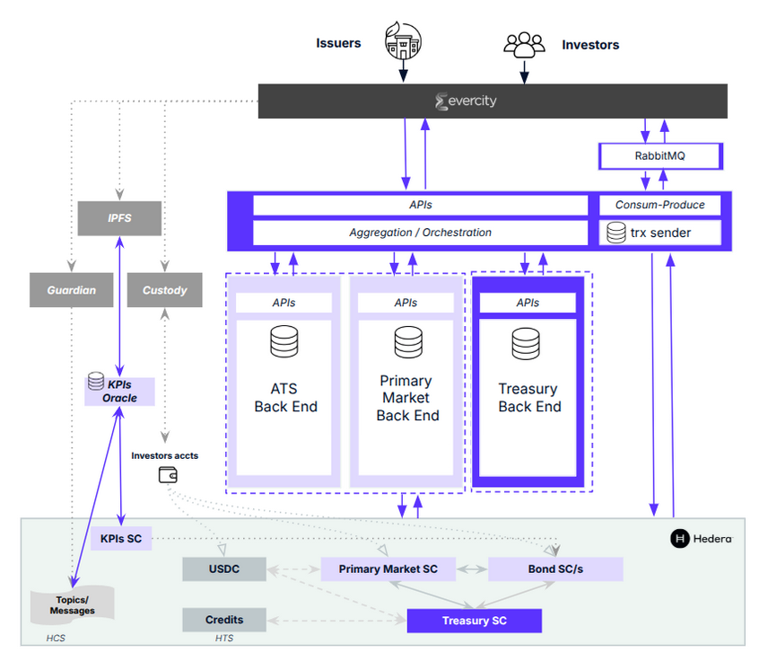
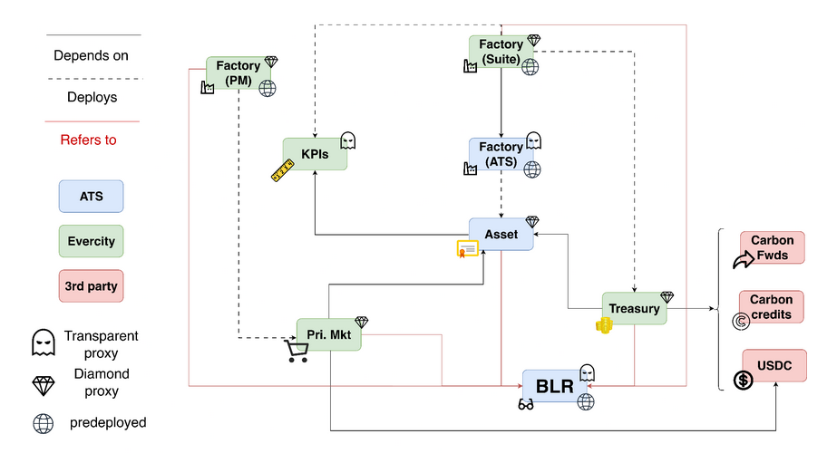
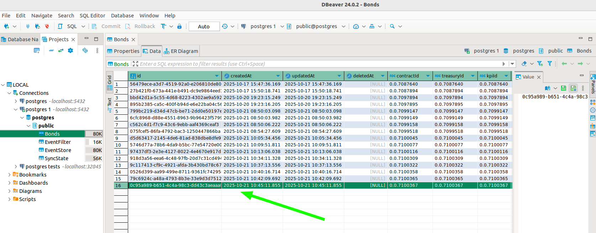

# Green Bonds Platform

[](LICENSE)

A monorepo platform for managing Green Bonds assets on Hedera and EVM blockchains, built with NestJS, TypeScript, Hardhat, and Solidity.

It follows Hexagonal Architecture and Domain-Driven Design (DDD) principles to ensure modularity, scalability, and maintainability.

### Table of Contents

- **[Features](#features)**
- **[Architecture](#architecture)**
- **[Prerequisites](#prerequisites)**
- **[Installation](#installation)**
- **[Configuration](#configuration)**
- **[Build shared packages](#build-shared-packages)**
- **[Green Bond Platform demo](#green-bond-platform-demo)**
- **[Adding app to monorepo](#adding-app-to-monorepo)**
- **[Testing](#testing)**
- **[Deployment](#deployment)**
- **[Contributing](#contributing)**
- **[License](#license)**

# Features

- **Blockchain Integration**: Support for Hedera and EVM networks (testnet, previewnet, mainnet).
- **API Management**: RESTful APIs for Green Bonds ATS (Asset Tokenization Studio) operations.
- **Smart Contracts**: Solidity contracts for bond issuance, trading, and lifecycle management.
- **Event Listening**: Real-time blockchain event monitoring with configurable polling.
- **Database Support**: PostgreSQL integration for data persistence.
- **Monorepo Structure**: Organized workspaces for apps, packages, and scripts using npm workspaces.
- **Quality Assurance**: Linting, formatting, and testing tools (ESLint, Prettier, Solhint).

# Architecture

The project adheres to Hexagonal Architecture and DDD:

- **Domain Layer**: Core business logic, entities, repositories, and domain services.
- **Application Layer**: Use cases, commands, queries, and application services.
- **Infrastructure Layer**: Ports and adapters for external integrations (e.g., blockchain, database).
- **Configuration**: Centralized config for environments and dependencies.





## Workspaces:

- `apps/`: Applications;
  - `gateway`: API gateway for routing requests to various services and handling authentication.
  - `transaction-sender`: Service for sending and managing blockchain transactions on Hedera or EVM networks. It uses RabbitMQ to receive and send messages to Evercity.
  - `ats`: Asset Tokenization Studio API for managing tokenized green bond assets, including issuance and trading.
  - `primary-market`: Application for handling primary market operations, such as initial bond offerings and investor subscriptions.
  - `treasury`: Treasury management service for tracking bond-related funds, payments, and financial reporting.
- `packages/`: Shared libraries;
  - `ats-contracts`: Solidity smart contracts for Asset Tokenization Studio, handling tokenization and management of green bond assets.
  - `primary-market-contracts`: Smart contracts for primary market operations, including bond issuance, subscriptions, and investor management.
  - `treasury-contracts`: Contracts for treasury management, tracking funds, payments, and financial reporting related to bonds.
  - `blockchain-listener`: Library for real-time event listening on Hedera or EVM blockchains, with configurable polling and contract monitoring.
  - `core`: Shared core utilities, including common models, services, and helpers for the platform.
- `scripts/`: Utility scripts for deployment and automation.

# Prerequisites

- Node.js (v22+)
- npm (v10+)
- PostgreSQL (for database)
- Hardhat (for smart contracts)
- Access to Hedera or EVM testnets (e.g., via Hedera SDK or Web3 providers)
- Docker containers

# Installation

1. Clone the repository:

   ```bash
   git clone git@github.com:hashgraph/green-bond-platform.git
   cd green-bond-platform
   ```

2. Change to develop branch (temporal)

   ```bash
   git checkout develop
   ```

3. Install dependencies
   ```bash
   npm ci
   ```

# Configuration

## Gateway

1. Copy the example environment file:
   ```bash
   cp apps/shared/gateway/.env.sample apps/shared/gateway/.env
   ```

## Transaction Sender

1. Copy the example environment file:
   ```bash
   cp apps/shared/transaction-sender/.env.example apps/shared/transaction-sender/.env
   ```

## ATS

1. Copy the example environment file:
   ```bash
   cp apps/ats/api/.env.example apps/ats/api/.env
   ```

## Primary Market

1. Copy the example environment file:
   ```bash
   cp apps/primary-market/api/.env.example apps/primary-market/api/.env
   ```

## Treasury

1. Copy the example environment file:
   ```bash
   cp apps/treasury/api/.env.example apps/treasury/api/.env
   ```

# Build shared packages

1. First compile the smart contracts

```bash
npm run contracts:build
```

2. Then build the solution

```bash
npm run shared:build
```

# Green Bond Platform demo

Previously finish [Installation](#installation) and [Configuration](#configuration) steps.

In scripts folder there are some tools for helping demos and testing end-to-end.

## Start GBP platform

1. Copy the example environment file:

   ```bash
   cp scripts/.env.example scripts/.env
   ```

2. Configure scripts/.env properties:
   If you are going to use an **ED25519** Hedera address to sign transactions, configure .env in this way:

   ```bash
   BLOCKCHAIN_FORMAT=hedera
   HEDERA_PRIVATE_KEY=\<add here the ED25519 private key in DER format\>
   ACCOUNT_ID=\<add here the Hedera ID\>
   ```

   If you are going to use an **ECDSA** Hedera address to sign transactions, configure .env in this way:

   ```bash
   BLOCKCHAIN_FORMAT=ethereum
   ETHEREUM_PRIVATE_KEY=\<add here the ECDSA private key in HEX format\>
   ACCOUNT_ID=\<add here the Hedera ID\>
   ```

3. Start Green Bond Platform:

> Make sure docker is running

```bash
npm run scripts:gbp:start
```

When the script finishes you will see this message:

```bash
🎉 Infrastructure startup complete!

📊 Running services:
• ATS API: Ready
• API Gateway: Ready
• Transaction Sender: Ready

🌐 Access Points:
• API Gateway: http://localhost:3000 (🔒 Requires x-api-key header)
• ATS API (Direct): http://localhost:3001/api/v1/ats
• Swagger ATS API (Direct): http://localhost:3001/api
• ATS API (via Gateway): http://localhost:3000/api/v1/ats
• Transaction Sender: http://localhost:3005
• PgAdmin: http://localhost:5050 (admin@admin.com/admin)
• RabbitMQ: http://localhost:15672 (guest/guest)

🔑 API Keys (for gateway access):
• demo-key-1

⚠️  Press Ctrl+C to stop all services
```

## Test GBP demo

These tests will test the Green Bond Platform end-to-end.
You can execute them in a different terminal than the one where you started the platform.

- Each test calls API Gateway, the API Gateway calls the API backend and returns the unsigned transaction.
- The unsigned transaction is signed with the address configured in .env file and sends a message to the RabbitMQ.
- The transaction sender reads the message and sends it to the Hedera testnet.
- The API backend reads the event from the Hedera testnet and saves the data in the PostgreSQL database.

### Create Green Bond

To deploy a green bond on the Hedera testnet, you can execute this command

```bash
npm run scripts:test:bond
```

When the script finishes, you will see this message in the console where you executed the command:

```bash
ℹ️  Using ETHEREUM blockchain format
✅ ETHEREUM bond transaction signed successfully!

🐰 Publishing ETHEREUM transaction to RabbitMQ...
✅ Message published to ethereumFormat.incoming
   Exchange: tx
   Routing Key: ethereumFormat.incoming
   Payload: 0xf9076f820103858bb2c9700083e4e1c09400000000000000...

🎉 Bond Creation Simulation Completed!
✅ Created and signed ETHEREUM bond transaction
✅ Published signed transaction to message queue
```

You will see these logs in the console where you started the Green Bond Platform:

```bash
[ATS API] [Nest] 1355228  - 10/21/2025, 12:45:11 PM     LOG [Blockchain-Listener] Processing event BondDeployed from block 26498678
[ATS API] [Nest] 1355228  - 10/21/2025, 12:45:11 PM     LOG [NestJSCommandBus] Executing command ProcessEventCommand
[ATS API] [Nest] 1355228  - 10/21/2025, 12:45:11 PM     LOG [NestJSCommandBus] Executing command CreateBondCommand
[ATS API] [Nest] 1355228  - 10/21/2025, 12:45:11 PM     LOG [NestJSEventBus] Event CreatedBondEvent published successfully:
[ATS API] [Nest] 1355228  - 10/21/2025, 12:45:11 PM     LOG [NestJSEventBus] CreatedBondEvent {
[ATS API] timestamp: 1761043511858,
[ATS API] contractId: '0.0.7100367',
[ATS API] treasuryId: '0.0.7100367',
[ATS API] kpiId: '0.0.7100367',
[ATS API] name: 'test',
[ATS API] symbol: 'test',
[ATS API] isin: 'US0378331005',
[ATS API] decimals: 6,
[ATS API] currency: 'h',
[ATS API] nominalValue: '100',
[ATS API] startingDate: 2029-08-09T19:20:00.000Z,
[ATS API] maturityDate: 2032-10-10T05:06:40.000Z,
[ATS API] maxSupply: '1000000'
[ATS API] }
[ATS API] [Nest] 1355228  - 10/21/2025, 12:45:11 PM     LOG [NestJSEventBus] Event EventProcessedEvent published successfully:
[ATS API] [Nest] 1355228  - 10/21/2025, 12:45:11 PM     LOG [NestJSEventBus] EventProcessedEvent {
[ATS API] timestamp: 1761043511860,
[ATS API] id: '99c6de77-4830-467a-a283-8682d22949d6',
[ATS API] eventName: 'BondDeployed',
[ATS API] status: 'PROCESSED',
[ATS API] errorReason: null
[ATS API] }
```

You can check the PostgreSQL database to verify that the bond has been created in the Bonds table:


## Stop GBP demo

To stop the platform execute this command:

```bash
npm run scripts:gbp:stop
```

# Adding a new app to monorepo

```bash
nest generate app <app-name> <workspace-name>
```

This command creates a folder inside `apps/<workspace-name>/<app-name>` with a basic NestJS structure.

# Testing

In each specific workspace:

- Unit tests: `npm run test`
- E2E tests: `npm run test:e2e`
- Coverage: `npm run test:cov`

# Deployment

- Smart Contract factories have to be deployed on the Hedera network before starting the platform.
- Use Docker for containerized deployment of each backend application.
- Refer to [NestJS Deployment Docs](https://docs.nestjs.com/deployment) for more information.

# Contributing

1. Follow the architecture guidelines.
2. Run `npm run lint` and `npm run format` before committing.
3. Submit pull requests with clear descriptions.

# License

Licensed under Apache 2.0. See [LICENSE](LICENSE) for details.
