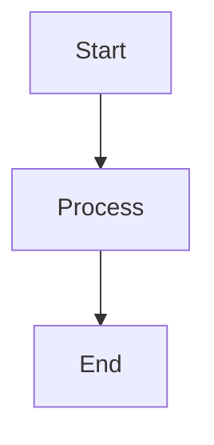

# Mermaid Diagram Support - Setup Complete

## Problem

Mermaid diagrams were not rendering correctly in the documentation.

## Solution

Added official Docusaurus Mermaid theme support.

## Changes Made

### 1. Package Installation

Added `@docusaurus/theme-mermaid` to [package.json](package.json):

```json
"dependencies": {
  "@docusaurus/theme-mermaid": "3.9.2",
  ...
}
```

### 2. Docusaurus Configuration

Updated [docusaurus.config.ts](docusaurus.config.ts) to enable Mermaid:

```typescript
markdown: {
  mermaid: true,
},

themes: ['@docusaurus/theme-mermaid'],
```

## Verification

**Build Status**: Successfully builds with Mermaid support

```bash
npm run build
[SUCCESS] Generated static files in "build".
```

**Dev Server**: Running at http://localhost:3010/green-bond-platform/

## Mermaid Diagrams in Documentation

### Treasury - How It Works

- **Payment Lifecycle**: Graph diagram showing payment flow
- **Maturity Redemption**: Sequence diagram for redemption process

### Primary Market - How It Works

- **Offering Lifecycle**: Linear flow diagram

### Usage

Simply use mermaid code blocks in markdown:

````markdown

````

## Testing

1. Start dev server: `npm run start`
2. Navigate to http://localhost:3010/green-bond-platform/docs/treasury/how-it-works
3. Verify both Mermaid diagrams render correctly
4. Check http://localhost:3010/green-bond-platform/docs/primary-market/how-it-works

## Resources

- [Docusaurus Mermaid Documentation](https://docusaurus.io/docs/markdown-features/diagrams)
- [Mermaid Syntax](https://mermaid.js.org/intro/)
