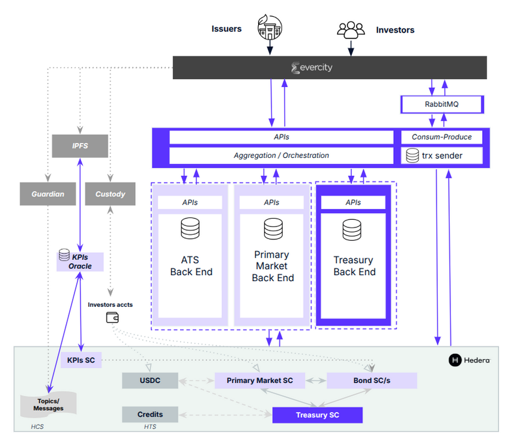
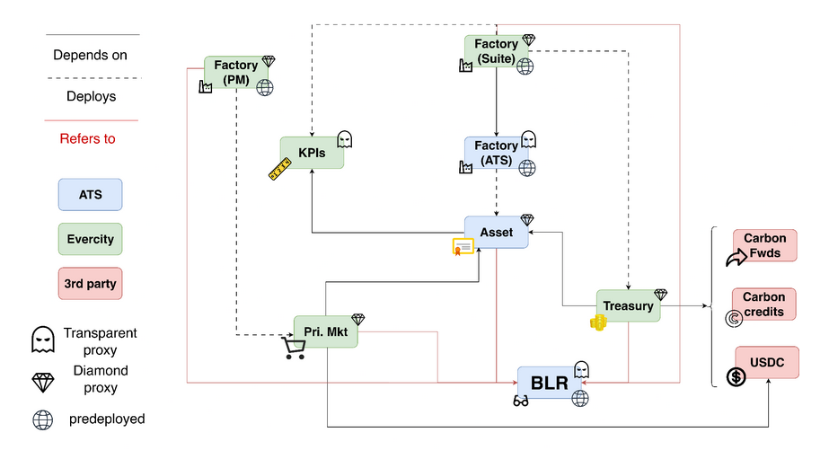

# Architecture

The Green Bond Platform follows **Hexagonal Architecture** and **Domain-Driven Design (DDD)** principles to ensure modularity, scalability, and maintainability.

## Architecture Layers

### Domain Layer

Contains the core business logic, entities, repositories, and domain services. This layer is independent of any framework or external technology.

**Components:**

- Domain entities (Bond, Subscription, Treasury Account, etc.)
- Value Objects
- Domain Services
- Repository Interfaces

### Application Layer

Contains use cases, commands, queries, and application services that orchestrate domain logic.

**Components:**

- Use Cases
- Commands and Command Handlers
- Queries and Query Handlers
- Application Services
- DTOs (Data Transfer Objects)

### Infrastructure Layer

Implements ports and adapters for external integrations such as blockchain, database, and external APIs.

**Components:**

- Blockchain Adapters (Hedera)
- Database Adapters (PostgreSQL)
- HTTP Controllers (NestJS Controllers)
- Event Listeners
- Message Queues (RabbitMQ)

### Configuration Layer

Centralized configuration for environments and dependencies.

## Platform Architecture Diagram



## Smart Contracts Architecture Diagram



## Monorepo Workspaces

### Apps (Applications)

#### Gateway

- **Purpose**: API Gateway for request routing and authentication
- **Port**: 3000
- **Responsibilities**:
  - JWT Authentication
  - Request routing to microservices
  - Rate limiting
  - CORS handling

#### Transaction Sender

- **Purpose**: Service for sending and managing blockchain transactions
- **Port**: 3004
- **Responsibilities**:
  - Receive transactions via RabbitMQ
  - Sign transactions with private keys
  - Send transactions to Hedera Network
  - Confirm transaction status

#### ATS API

- **Purpose**: Asset Tokenization Studio API
- **Port**: 3001
- **Responsibilities**:
  - Tokenized bond management
  - Token issuance
  - Token transfers
  - State queries

#### Primary Market API

- **Purpose**: API for primary market operations
- **Port**: 3002
- **Responsibilities**:
  - Bond offering management
  - Investor subscriptions
  - Bond allocation
  - KYC/AML verification

#### Treasury API

- **Purpose**: API for treasury management
- **Port**: 3003
- **Responsibilities**:
  - Fund tracking
  - Payment management
  - Financial reports
  - Coupon distributions

### Packages (Shared Packages)

#### Contracts

- **ats/contracts**: Asset Tokenization Studio smart contracts
- **primary-market/contracts**: Primary market smart contracts
- **treasury/contracts**: Treasury smart contracts
- **shared/contracts**: Shared contracts between modules

#### Libraries

- **shared/blockchain-listener**: Library for listening to blockchain events
- **shared/core**: Common utilities and services
- **shared/testing**: Shared testing utilities

### Scripts

Deployment and automation utilities for:

- Contract deployment
- Role configuration
- Bond initialization
- Integration testing

## Data Flow

### 1. Bond Creation

```
User → Gateway → ATS API → Smart Contract → Blockchain
                           ↓
                        Database
```

### 2. Bond Subscription

```
Investor → Gateway → Primary Market API → Smart Contract → Blockchain
                                        ↓
                                   Transaction Sender
                                        ↓
                                     Database
```

### 3. Event Listening

```
Blockchain → Blockchain Listener → Event Handler → Database
```

## Design Patterns Used

### Repository Pattern

Abstraction of the persistence layer to facilitate testing and database changes.

### CQRS (Command Query Responsibility Segregation)

Separation of read and write operations for better scalability.

### Event Sourcing

Storage of domain events for auditing and state reconstruction.

### Adapter Pattern

Abstraction of external services (blockchain, database) to facilitate changes.

### Factory Pattern

Creation of complex domain objects.

## Main Technologies

- **Backend**: NestJS, TypeScript
- **Blockchain**: Hedera SDK, Hardhat, Solidity, Ethers.js
- **Database**: PostgreSQL, TypeORM
- **Messaging**: RabbitMQ
- **Testing**: Jest, Supertest
- **Code Quality**: ESLint, Prettier, Solhint

## Scalability

The architecture is designed to scale horizontally:

- Each API can run in multiple instances
- Load balancer in front of the Gateway
- Database with read/write replication
- Message queue for asynchronous processing
- Distributed cache (Redis) to improve performance

## Security

- JWT authentication at the Gateway
- Roles and permissions in smart contracts
- Private key encryption
- Audit of all operations
- Rate limiting to prevent abuse

The Green Bond platform follows **Hexagonal Architecture** and **Domain-Driven Design (DDD)** principles to ensure modularity, scalability, and maintainability.

## Architecture Layers

### Domain Layer

Contains the core business logic, entities, repositories, and domain services. This layer is independent of any framework or external technology.

**Components:**

- Domain entities (Bond, Subscription, Treasury Account, etc.)
- Value Objects
- Domain Services
- Repository Interfaces

### Application Layer

Contains use cases, commands, queries, and application services that orchestrate domain logic.

**Components:**

- Use Cases
- Commands and Command Handlers
- Queries and Query Handlers
- Application Services
- DTOs (Data Transfer Objects)

### Infrastructure Layer

Implements ports and adapters for external integrations such as blockchain, database, and external APIs.

**Components:**

- Blockchain Adapters (Hedera)
- Database Adapters (PostgreSQL)
- HTTP Controllers (NestJS Controllers)
- Event Listeners
- Message Queues (RabbitMQ)

### Configuration Layer

Centralized configuration for environments and dependencies.

## Platform Architecture Diagram


## Smart Contracts Architecture Diagram


## Monorepo Workspaces

### Apps (Applications)

#### Gateway

- **Purpose**: API Gateway para enrutamiento de solicitudes y autenticación
- **Port**: 3000
- **Responsibilities**:
  - JWT Authentication
  - Request routing to microservices
  - Rate limiting
  - CORS handling

#### Transaction Sender

- **Purpose**: Service for sending and managing blockchain transactions
- **Port**: 3004
- **Responsibilities**:
  - Receive transactions via RabbitMQ
  - Sign transactions with private keys
  - Send transactions to Hedera Network
  - Confirm transaction status

#### ATS API

- **Purpose**: API de Asset Tokenization Studio
- **Port**: 3001
- **Responsibilities**:
  - Tokenized bond management
  - Token issuance
  - Token transfers
  - State queries

#### Primary Market API

- **Purpose**: API for primary market operations
- **Port**: 3002
- **Responsibilities**:
  - Bond offering management
  - Investor subscriptions
  - Bond allocation
  - KYC/AML verification

#### Treasury API

- **Purpose**: API for treasury management
- **Port**: 3003
- **Responsibilities**:
  - Fund tracking
  - Payment management
  - Financial reports
  - Coupon distributions

### Packages (Shared Packages)

#### Contracts

- **ats/contracts**: Smart contracts de Asset Tokenization Studio
- **primary-market/contracts**: Smart contracts smart contracts
- **treasury/contracts**: Smart contracts smart contracts
- **shared/contracts**: Contracts compartidos entre modules

#### Libraries

- **shared/blockchain-listener**: Library for listening to blockchain events
- **shared/core**: Common utilities and services
- **shared/testing**: Shared testing utilities

### Scripts

Deployment and automation utilities for:

- Contract deployment
- Role configuration
- Bond initialization
- Integration testing

## Data Flow

### 1. Bond Creation

```
User → Gateway → ATS API → Smart Contract → Blockchain
                              ↓
                         Database
```

### 2. Bond Subscription

```
Investor → Gateway → Primary Market API → Smart Contract → Blockchain
                                        ↓
                                   Transaction Sender
                                        ↓
                                   Database
```

### 3. Event Listening

```
Blockchain → Blockchain Listener → Event Handler → Database
```

## Design Patterns Used

### Repository Pattern

Abstraction of the persistence layer to facilitate testing and database changes.

### CQRS (Command Query Responsibility Segregation)

Separation of read and write operations for better scalability.

### Event Sourcing

Storage of domain events for auditing and state reconstruction.

### Adapter Pattern

Abstraction of external services (blockchain, database) to facilitate changes.

### Factory Pattern

Creation of complex domain objects.

## Main Technologies

- **Backend**: NestJS, TypeScript
- **Blockchain**: Hedera SDK, Hardhat, Solidity, Ethers.js
- **Database**: PostgreSQL, TypeORM
- **Messaging**: RabbitMQ
- **Testing**: Jest, Supertest
- **Code Quality**: ESLint, Prettier, Solhint

## Scalability

The architecture is designed to scale horizontally:

- Each API can run in multiple instances
- Load balancer in front of the Gateway
- Base de datos with read/write replication
- Message queue for asynchronous processing
- Distributed cache (Redis) to improve performance

## Security

- JWT Authentication at the Gateway
- Roles and permissions in smart contracts
- Private key encryption
- Audit of all operations
- Rate limiting to prevent abuse
