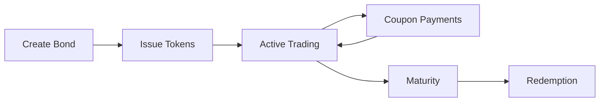

# How ATS Works

Detailed explanation of how the Asset Tokenization Studio works.

## Bond Lifecycle



## 1. Bond Creation

### Process Flow

1. **Request**: Issuer submits bond parameters via API
2. **Validation**: System validates bond configuration
3. **Smart Contract**: Deploy bond smart contract
4. **Token Creation**: Create HTS token on Hedera
5. **Database**: Store bond metadata
6. **Response**: Return bond ID and token ID

### Example Request

```typescript
POST /api/bonds

{
  "name": "Green Energy Bond 2026",
  "symbol": "GEB26",
  "totalSupply": 1000000,
  "denomination": 1000,
  "maturityDate": "2026-12-31",
  "interestRate": 4.5,
  "currency": "USD",
  "environmental": {
    "category": "renewable_energy",
    "expectedImpact": "500 tons CO2 reduction"
  }
}
```

## 2. Token Issuance

### Issuance Flow

1. **KYC Verification**: Verify investor eligibility
2. **Allocation**: Assign tokens to investor
3. **Transfer**: Execute HTS transfer on Hedera
4. **Record**: Update database records
5. **Event**: Emit token issued event

### Smart Contract Interaction

```solidity
function issueTokens(address investor, uint256 amount) external onlyIssuer {
  require(investors[investor].kyc, "KYC not verified");
  _transfer(address(this), investor, amount);
  emit TokensIssued(investor, amount);
}
```

## 3. Token Transfers

### Transfer Process

1. **Authorization**: Verify sender owns tokens
2. **Compliance**: Check transfer restrictions
3. **Execute**: Perform HTS transfer
4. **Update**: Update ownership records
5. **Notify**: Send notifications

### Transfer Types

- **Primary Market**: Issuer to investor
- **Secondary Market**: Investor to investor
- **Redemption**: Investor to issuer

## 4. State Management

### Bond States

```typescript
enum BondState {
  DRAFT = "draft",
  PENDING_APPROVAL = "pending_approval",
  ACTIVE = "active",
  SUSPENDED = "suspended",
  MATURED = "matured",
  REDEEMED = "redeemed",
}
```

### State Transitions

- `DRAFT` → `PENDING_APPROVAL`: Submit for approval
- `PENDING_APPROVAL` → `ACTIVE`: Approve bond
- `ACTIVE` → `SUSPENDED`: Pause trading
- `SUSPENDED` → `ACTIVE`: Resume trading
- `ACTIVE` → `MATURED`: Reach maturity date
- `MATURED` → `REDEEMED`: Complete redemption

## 5. Event Handling

### Event Types

```typescript
// Bond events
BondCreated;
BondApproved;
BondSuspended;
BondMatured;

// Token events
TokensIssued;
TokensTransferred;
TokensBurned;

// Coupon events
CouponPaid;
CouponScheduled;
```

### Event Listeners

```typescript
@EventPattern('bond.created')
async handleBondCreated(data: BondCreatedEvent) {
  await this.notificationService.sendNotification({
    type: 'bond_created',
    recipients: data.subscribers,
    data: {
      bondId: data.bondId,
      name: data.name
    }
  });
}
```

## 6. Data Persistence

### Entity Relationships

```
Bond
├── Tokens (1:N)
├── Transactions (1:N)
├── CouponPayments (1:N)
└── EnvironmentalMetrics (1:1)
```

### Database Schema

```sql
CREATE TABLE bonds (
    id UUID PRIMARY KEY,
    name VARCHAR(255) NOT NULL,
    token_id VARCHAR(50) NOT NULL,
    total_supply BIGINT NOT NULL,
    maturity_date DATE NOT NULL,
    interest_rate DECIMAL(5,2),
    state VARCHAR(20) NOT NULL,
    created_at TIMESTAMP DEFAULT NOW()
);

CREATE TABLE tokens (
    id UUID PRIMARY KEY,
    bond_id UUID REFERENCES bonds(id),
    owner_account VARCHAR(50) NOT NULL,
    amount BIGINT NOT NULL,
    created_at TIMESTAMP DEFAULT NOW()
);
```

## 7. Integration Points

### External Systems

- **Primary Market**: Bond subscriptions
- **Treasury**: Payment processing
- **Gateway**: Authentication and routing
- **Transaction Sender**: Blockchain transaction handling

### API Communication

```typescript
// Call Primary Market
const subscription = await this.primaryMarketClient.createSubscription({
  bondId: bond.id,
  investorId: investor.id,
  amount: 10000,
});

// Call Treasury
await this.treasuryClient.scheduleCouponPayment({
  bondId: bond.id,
  amount: couponAmount,
  paymentDate: nextCouponDate,
});
```

## Security Measures

1. **Access Control**: Role-based permissions
2. **Encryption**: Sensitive data encrypted at rest
3. **Audit Logs**: All operations logged
4. **Rate Limiting**: API endpoint protection
5. **Input Validation**: Strict parameter validation

## Performance Optimization

- **Caching**: Redis for frequently accessed data
- **Indexing**: Database indexes on key fields
- **Pagination**: Large result sets paginated
- **Async Processing**: Background jobs for heavy operations

## Next Steps

- [API Reference](api-guide.md)
- [Smart Contracts](smart-contracts.md)
