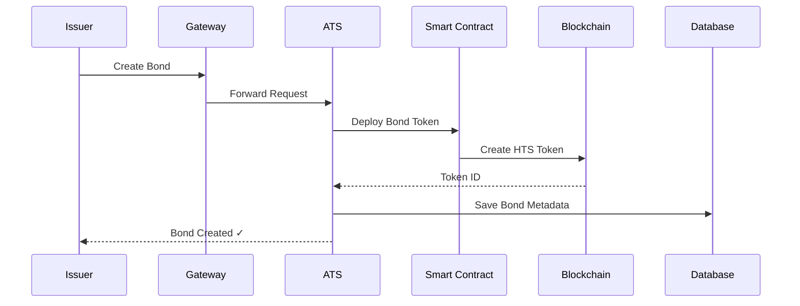
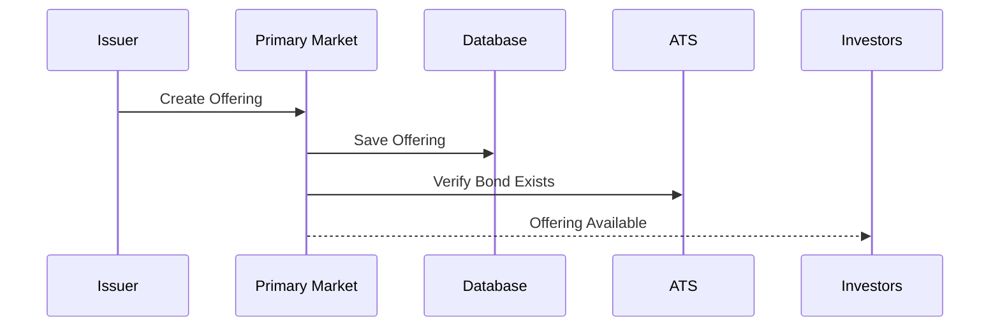
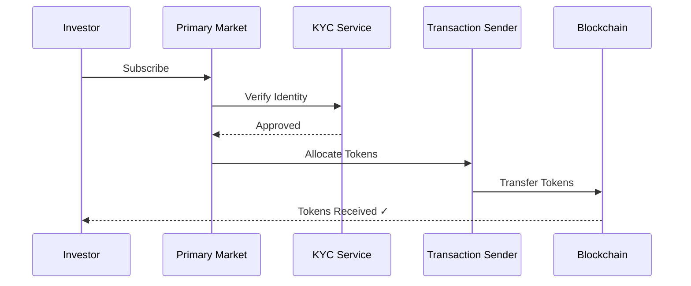
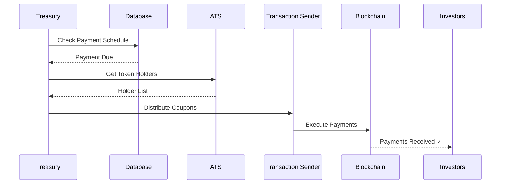

# Green Bond Platform

A comprehensive open-source platform for managing the complete lifecycle of Green Bond assets on blockchain, built with NestJS, TypeScript, Hardhat, and Solidity.

## What are Green Bonds?

**Green Bonds** are fixed-income financial instruments specifically designated to raise capital for projects with environmental benefits. They work like regular bonds but the funds must be exclusively used for:

- Renewable energy projects
- Green buildings and energy efficiency
- Clean transportation
- Water and waste management
- Climate change adaptation
- Circular economy initiatives

Green bonds have grown from $11 billion in 2013 to over $500 billion annually, but the market faces challenges:

- **Lack of transparency** in fund allocation
- **Complex verification** of environmental impact
- **High administrative costs**
- **Limited accessibility** for smaller investors
- **Greenwashing risks**

## Why Blockchain for Green Bonds?

Blockchain technology addresses these challenges by providing:

| Challenge          | Blockchain Solution                                           |
| ------------------ | ------------------------------------------------------------- |
| **Transparency**   | Immutable ledger tracks every transaction and fund allocation |
| **Verification**   | Smart contracts automate compliance and reporting             |
| **Cost Reduction** | Automated processes reduce intermediaries and fees            |
| **Accessibility**  | Fractional ownership enables smaller investments              |
| **Trust**          | Cryptographic proofs eliminate greenwashing concerns          |
| **Efficiency**     | 24/7 trading and instant settlement                           |

## What is Green Bond Platform?

Green Bond Platform is a **production-ready, open-source solution** for digitalizing the entire lifecycle of green bond assets on Hedera Network blockchain.

### Built for the Real World

The platform implements industry standards and best practices:

- **Production-ready**: Battle-tested architecture and security patterns
- **Standards-compliant**: Follows ICMA Green Bond Principles
- **Enterprise-grade**: Hexagonal Architecture and Domain-Driven Design (DDD)
- **Secure**: Multi-layer security with role-based access control
- **Scalable**: Microservices architecture for independent scaling
- **Open Source**: Apache 2.0 licensed for maximum flexibility

### Why Hedera?

The platform uses **Hedera Hashgraph** for its unique advantages:

- **Fast**: 3-5 second finality
- **Low Cost**: Predictable fees ($0.0001 per transaction)
- **Sustainable**: Carbon-negative network
- **Secure**: Asynchronous Byzantine Fault Tolerant (aBFT) consensus
- **Governed**: Decentralized governance council with global enterprises

## Key Features

### Complete Bond Lifecycle Management

- **Issuance**: Create and tokenize green bonds on blockchain
- **Subscription**: Investor onboarding and bond allocation
- **Trading**: Secondary market operations (future)
- **Payments**: Automated coupon and principal payments
- **Reporting**: Real-time environmental impact tracking
- **Redemption**: Automated bond maturity handling

### Technical Excellence

- **Hexagonal Architecture**: Clean separation of concerns
- **Domain-Driven Design**: Models real-world bond operations
- **Event-Driven**: Real-time blockchain event processing
- **Thoroughly Tested**: Unit, integration, and E2E tests
- **Well Documented**: Comprehensive API and architecture docs
- **Developer Friendly**: Modern tooling and monorepo structure

## Main Components

The platform consists of five interconnected microservices, each handling a specific domain:

### 1. [Gateway](gateway/overview) - API Gateway & Authentication

Your entry point to the platform. Handles:

- JWT-based authentication and authorization
- Request routing to microservices
- Rate limiting and CORS
- Centralized logging and monitoring

**Port**: 3000 | **Tech**: NestJS, Passport, JWT

### 2. [ATS (Asset Tokenization Studio)](ats/overview) - Bond Tokenization

Manages the tokenization of green bond assets. Features:

- Create and mint bond tokens on Hedera
- Bond metadata and characteristics management
- Token queries and balance tracking
- Role-based access control (RBAC)

**Port**: 3001 | **Tech**: NestJS, Hedera SDK, Solidity

### 3. [Primary Market](primary-market/overview) - Bond Issuance & Subscriptions

Handles the initial offering and investor subscriptions:

- Bond offering creation and management
- Investor onboarding and KYC integration
- Subscription processing and allocation
- Compliance and regulatory checks

**Port**: 3002 | **Tech**: NestJS, PostgreSQL, TypeORM

### 4. [Treasury](treasury/overview) - Financial Management

Manages all financial operations:

- Fund tracking and reconciliation
- Coupon payment scheduling and execution
- Principal payment at maturity
- Financial reporting and analytics

**Port**: 3003 | **Tech**: NestJS, PostgreSQL, Solidity

### 5. [Transaction Sender](transaction-sender/overview) - Blockchain Transaction Management

Dedicated service for blockchain interactions:

- Transaction signing and submission
- Transaction status monitoring
- Retry logic and error handling
- RabbitMQ integration for async processing

**Port**: 3004 | **Tech**: NestJS, Hedera SDK, RabbitMQ

## Platform Architecture

The project is organized as a monorepo with three main workspace types:

### Apps (`apps/`)

Five microservices that form the platform:

- **gateway**: API Gateway and authentication
- **transaction-sender**: Blockchain transaction management
- **ats**: Asset tokenization service
- **primary-market**: Bond issuance and subscriptions
- **treasury**: Financial operations and payments

### Packages (`packages/`)

Shared libraries used across services:

- **contracts**: Solidity smart contracts (ATS, Primary Market, Treasury)
- **blockchain-listener**: Real-time event monitoring
- **core**: Common utilities, models, and helpers
- **testing**: Shared test utilities and fixtures

### Scripts (`scripts/`)

Deployment and automation tools:

- Contract deployment scripts
- Role configuration utilities
- Integration test helpers
- Database initialization

### Architectural Principles

The platform follows enterprise software engineering best practices:

#### Hexagonal Architecture (Ports & Adapters)

```
┌────────────────────────────────────┐
│         Application Core           │
│   (Domain + Application Logic)     │
│                                    │
│  ┌──────────────────────────────┐  │
│  │      Domain Layer            │  │
│  │  • Entities                  │  │
│  │  • Value Objects             │  │
│  │  • Domain Services           │  │
│  └──────────────────────────────┘  │
│                                    │
│  ┌──────────────────────────────┐  │
│  │   Application Layer          │  │
│  │  • Use Cases                 │  │
│  │  • Commands/Queries          │  │
│  └──────────────────────────────┘  │
└────────────────────────────────────┘
         ↕                    ↕
    ┌─────────┐          ┌─────────┐
    │ Adapters│          │ Adapters│
    │  (In)   │          │  (Out)  │
    │         │          │         │
    │ • REST  │          │ • DB    │
    │ • gRPC  │          │ • Chain │
    └─────────┘          └─────────┘
```

#### Domain-Driven Design (DDD)

- **Bounded Contexts**: Each service is an independent bounded context
- **Ubiquitous Language**: Code reflects business terminology
- **Aggregates**: Consistent transaction boundaries
- **Events**: Domain events for inter-service communication

## How It Works: Bond Lifecycle Flow

Let's follow a green bond from creation to maturity:

### 1. Bond Creation (Issuer → ATS)



### 2. Offering Launch (Issuer → Primary Market)



### 3. Investor Subscription (Investor → Primary Market)



### 4. Coupon Payment (Treasury → Automated)



## Real-World Use Cases

### 1. Corporate Green Bond Issuance

A renewable energy company can:

- Issue $10M green bond to fund solar projects
- Tokenize the bond on Hedera (1000 tokens @ $10,000 each)
- Accept investor subscriptions through the platform
- Automate semi-annual coupon payments
- Track and report solar energy production impact

### 2. Municipal Green Infrastructure Bonds

A city government can:

- Finance green building projects
- Enable fractional ownership ($1,000 minimum)
- Provide transparent fund allocation reports
- Automate compliance with green bond standards
- Reduce administrative costs by 40-60%

### 3. Sustainable Development Projects

International organizations can:

- Fund climate adaptation projects
- Offer bonds to global investors 24/7
- Provide real-time impact metrics
- Reduce settlement times from days to seconds
- Ensure funds are used for designated projects

## Technology Stack

### Backend & APIs

- **Framework**: NestJS (Node.js with TypeScript)
- **Architecture**: Hexagonal + DDD
- **Database**: PostgreSQL with TypeORM
- **Message Queue**: RabbitMQ for async processing
- **API Documentation**: Swagger/OpenAPI

### Blockchain

- **Network**: Hedera Hashgraph
- **Smart Contracts**: Solidity (compatible with EVM)
- **Development**: Hardhat for compilation and testing
- **Token Standard**: Hedera Token Service (HTS)
- **Consensus**: Hedera SDK for transaction submission

### Quality & DevOps

- **Testing**: Jest (unit, integration, E2E)
- **Linting**: ESLint for JS/TS, Solhint for Solidity
- **Formatting**: Prettier
- **Containerization**: Docker & Docker Compose
- **Monitoring**: Structured logging with Winston

### Monorepo Management

- **Package Manager**: npm workspaces
- **Build System**: Custom npm scripts
- **Version Control**: Git with conventional commits

## Next Steps

Choose your learning path based on your role:

### Business Stakeholders

1. [Understand the Architecture](architecture.md) - High-level system design
2. [Explore Components](ats/overview) - What each service does
3. [See Use Cases](#real-world-use-cases) - Real-world applications

### Developers

1. [Getting Started Guide](getting-started.md) - Complete setup walkthrough
2. [Installation](installation.md) - Detailed installation steps
3. [Configuration](configuration.md) - Environment setup
4. [Development Guide](development/contributing.md) - Contributing to the project

### DevOps Engineers

1. [Prerequisites](prerequisites.md) - Infrastructure requirements
2. [Deployment Guide](development/deployment.md) - Production deployment
3. [Configuration](configuration.md) - Environment variables

### QA Engineers

1. [Testing Guide](development/testing.md) - Test suites and strategies
2. [API Documentation](ats/overview) - Endpoint testing

## Support & Community

### Get Help

- **Documentation**: You're reading it! Browse the sidebar for specific topics
- **Bug Reports**: [GitHub Issues](https://github.com/hashgraph/green-bond-platform/issues)
- **Discussions**: [GitHub Discussions](https://github.com/hashgraph/green-bond-platform/discussions)
- **Email**: Contact the Hedera team for enterprise support

### Contributing

We welcome contributions! See our [Contributing Guide](development/contributing.md) for:

- Code of Conduct
- Development workflow
- Pull request process
- Coding standards

### Stay Updated

- Star the repo on [GitHub](https://github.com/hashgraph/green-bond-platform)
- Follow [Hedera on Twitter](https://twitter.com/hedera)
- Read the [Hedera Blog](https://hedera.com/blog)

## License

This project is licensed under **Apache License 2.0**.

You are free to:

- Use commercially
- Modify and distribute
- Use in proprietary software
- Patent use

See the [LICENSE](https://github.com/hashgraph/green-bond-platform/blob/main/LICENSE) file for full details.

---

## Ready to Start?

**New to the project?** Start with [Getting Started](getting-started.md)

**Want a quick overview?** Check out the [Architecture](architecture.md)

**Ready to code?** Jump to [Installation](installation.md)
