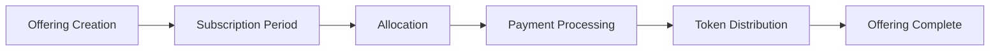
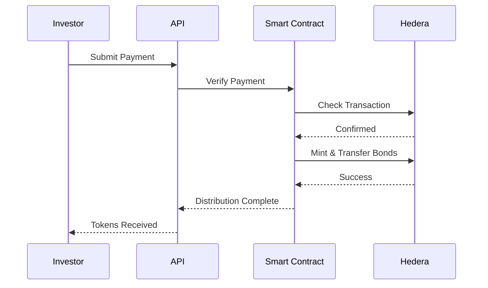

# How Primary Market Works

Comprehensive explanation of the primary market lifecycle and processes.

## Offering Lifecycle

The primary market handles the initial issuance of green bonds through a structured workflow:



## 1. Offering Creation

Issuers create bond offerings with specific parameters and subscription windows. Investments are denominated in **USDC (USD Coin)** to provide price stability and easy settlement.

### Process Flow

1. **Request Validation**: System validates offering parameters
2. **Smart Contract Deployment**: Deploy offering smart contract on Hedera
3. **Database Record**: Store offering metadata and configuration
4. **Notification**: Notify potential investors
5. **Subscription Window Opens**: Accept investor subscriptions

### Example Request

```typescript
POST / api / primary - market / offerings;
Authorization: Bearer <
  issuer - token >
  {
    bondId: "BOND001",
    bondName: "Green Energy Bond 2026",
    totalAmount: 1000000, // 1M USDC total offering
    denomination: 1000, // 1,000 USDC per bond
    minSubscription: 1000, // Minimum 1,000 USDC
    maxSubscription: 100000, // Maximum 100,000 USDC
    startDate: "2024-01-01T00:00:00Z",
    endDate: "2024-01-15T23:59:59Z",
    allocationMethod: "pro-rata",
    paymentToken: "0.0.429274", // USDC token on Hedera Testnet
  };
```

**Response:**

```json
{
  "offeringId": "OFF-2024-001",
  "status": "OPEN",
  "bondId": "BOND001",
  "subscriptionStats": {
    "totalSubscribed": 0,
    "investorCount": 0,
    "percentageFilled": 0
  },
  "timeline": {
    "openDate": "2024-01-01T00:00:00Z",
    "closeDate": "2024-01-15T23:59:59Z",
    "allocationDate": "2024-01-16T00:00:00Z"
  }
}
```

## 2. Subscription Process

Investors submit subscription requests during the offering period.

### Validation Steps

1. **Investor Authentication**: Verify investor identity and JWT token
2. **KYC/AML Check**: Validate investor compliance status
3. **Amount Validation**: Ensure subscription meets min/max requirements
4. **Duplicate Check**: Prevent multiple subscriptions from same investor
5. **Offering Status**: Verify offering is still open

### Example Subscription

```typescript
POST / api / primary - market / subscriptions;
Authorization: Bearer <
  investor - token >
  {
    offeringId: "OFF-2024-001",
    amount: 50000,
    investorDetails: {
      accountId: "0.0.98765",
      email: "investor@example.com",
      kycStatus: "VERIFIED",
    },
  };
```

**Response:**

```json
{
  "subscriptionId": "SUB-2024-12345",
  "offeringId": "OFF-2024-001",
  "status": "PENDING_ALLOCATION",
  "amount": 50000,
  "submittedAt": "2024-01-10T14:30:00Z",
  "estimatedAllocation": "TBD"
}
```

## 3. Allocation Algorithm

After the subscription period closes, the system allocates bonds to investors.

### Allocation Methods

#### Pro-Rata Allocation

Used when offering is oversubscribed. Each investor receives proportional allocation:

```typescript
// Pro-rata calculation
const totalSubscribed = 1500000; // Total subscription amount
const offeringSize = 1000000; // Total bonds available
const investorSubscription = 50000;

const allocationRatio = offeringSize / totalSubscribed; // 0.6667
const allocation = investorSubscription * allocationRatio; // 33,335
```

#### First-Come-First-Served

Allocates bonds in order of subscription until offering is filled.

#### Lottery System

Random allocation when subscriptions greatly exceed offering size.

### Allocation Process

```typescript
POST /api/primary-market/offerings/:id/allocate
Authorization: Bearer <admin-token>

// System automatically:
// 1. Retrieves all valid subscriptions
// 2. Applies allocation algorithm
// 3. Calculates final allocations
// 4. Updates subscription records
// 5. Sends allocation notifications
```

## 4. Payment & Distribution

After allocation, investors complete payment and receive tokens.

### Payment Workflow

Investors pay for their allocated bonds using **USDC**, which is held in an escrow smart contract until distribution is complete.

1. **Payment Instructions**: System sends USDC payment details to investors
2. **Payment Submission**: Investors transfer USDC to escrow contract
3. **Payment Verification**: Smart contract verifies USDC payment on-chain
4. **Token Minting**: Bond tokens minted for allocated amounts
5. **Token Distribution**: Bonds transferred to investor accounts
6. **Confirmation**: Both parties receive confirmation

### Example Payment

```typescript
POST /api/primary-market/subscriptions/:id/pay

{
  "transactionId": "0.0.12345@1234567890.123456789",  // USDC transfer transaction
  "amount": 33335,              // 33,335 USDC
  "paymentToken": "0.0.429274"  // USDC token ID on Hedera Testnet
}
```

### Distribution Flow



## Offering States

| State          | Description                        |
| -------------- | ---------------------------------- |
| `DRAFT`        | Offering created but not published |
| `OPEN`         | Accepting subscriptions            |
| `CLOSED`       | Subscription period ended          |
| `ALLOCATED`    | Bonds allocated to investors       |
| `DISTRIBUTING` | Tokens being distributed           |
| `COMPLETED`    | All tokens distributed             |
| `CANCELLED`    | Offering cancelled                 |

## Real-World Example

**Green Energy Infrastructure Bond 2026**

- **Offering Size**: 10,000,000 USDC
- **Denomination**: 1,000 USDC per bond
- **Payment Currency**: USDC (stablecoin)
- **Subscription Period**: 15 days
- **Total Subscriptions**: 15,000,000 USDC (150% subscribed)
- **Allocation Method**: Pro-rata
- **Average Allocation**: 66.67% of subscription
- **Investor Count**: 250
- **Distribution Time**: 2 hours after USDC payment verification

## Next Steps

- [API Guide](api-guide.md) - Complete API reference
- [Smart Contracts](smart-contracts.md) - Contract details
- [Installation](installation.md) - Setup guide
