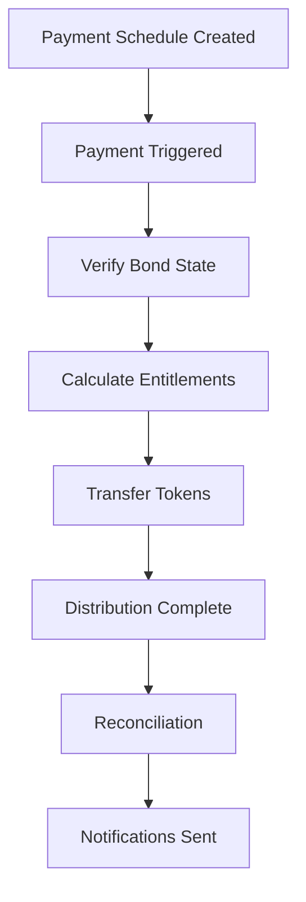
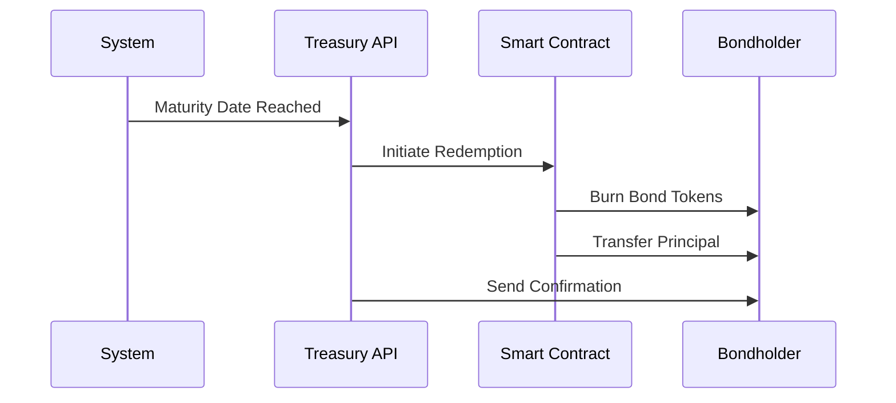

# How Treasury Works

Comprehensive explanation of treasury operations and payment management.

## Payment Lifecycle

The treasury manages all financial flows related to green bonds:



## 1. Coupon Payments

Regular interest payments to bondholders based on bond terms.

### Payment Schedule Setup

Payments are made in **USDC (USD Coin)**, a stablecoin pegged to the US dollar, ensuring price stability for bondholders.

```typescript
POST / api / treasury / payment - schedules;
Authorization: Bearer <
  issuer - token >
  {
    bondId: "BOND001",
    paymentType: "COUPON",
    schedule: {
      frequency: "QUARTERLY",
      startDate: "2024-03-31T00:00:00Z",
      endDate: "2026-12-31T00:00:00Z",
      rate: 4.5,
      paymentToken: "0.0.429274", // USDC token on Hedera Testnet
    },
  };
```

**Response:**

```json
{
  "scheduleId": "SCH-2024-001",
  "bondId": "BOND001",
  "nextPayment": {
    "date": "2024-03-31T00:00:00Z",
    "estimatedAmount": 11250,
    "status": "SCHEDULED"
  },
  "totalPayments": 12,
  "upcomingPayments": [...]
}
```

### Payment Execution Process

1. **Scheduled Trigger**: Bull queue job triggers payment at scheduled time
2. **Bond State Verification**: Confirm bond is active and not defaulted
3. **Holder Snapshot**: Retrieve all bond token holders at payment date
4. **Entitlement Calculation**: Calculate payment for each holder
5. **Token Transfer**: Transfer payment tokens from treasury to contract
6. **Distribution Execution**: Smart contract distributes to all holders
7. **Reconciliation**: Verify all payments successful
8. **Record Keeping**: Update database with payment records
9. **Notifications**: Send confirmations to all stakeholders

### Example Payment Execution

```typescript
// Automatic execution via scheduled job
POST /api/treasury/payments/execute/:scheduleId
Authorization: Bearer <system-token>

// Calculates and executes payment
{
  "bondId": "BOND001",
  "paymentDate": "2024-03-31T00:00:00Z",
  "holders": [
    { "accountId": "0.0.98765", "bondBalance": 50000, "payment": 562.50 },
    { "accountId": "0.0.98766", "bondBalance": 100000, "payment": 1125.00 }
  ],
  "totalAmount": 11250,
  "transactionId": "0.0.12345@1234567890.123456789"
}
```

### Coupon Calculation Formula

```typescript
// Quarterly coupon payment calculation in USDC
const principal = 50000; // Bond holdings in USD value
const annualRate = 0.045; // 4.5% annual rate
const paymentsPerYear = 4; // Quarterly

const couponPayment = (principal * annualRate) / paymentsPerYear;
// Result: 562.50 USDC per quarter
```

## 2. Bond Redemptions

Principal repayment at bond maturity or early redemption. Bondholders receive their principal in **USDC**, ensuring they get back the exact USD value invested.

### Maturity Redemption

Automatic redemption when bond reaches maturity date:



### Redemption Request

```typescript
POST / api / treasury / redemptions;
Authorization: Bearer <
  bondholder - token >
  {
    bondId: "BOND001",
    amount: 100000,
    redemptionType: "MATURITY",
    bondholderAccount: "0.0.98765",
  };
```

**Response:**

```json
{
  "redemptionId": "RED-2024-001",
  "status": "PROCESSING",
  "bondId": "BOND001",
  "amount": 100000,
  "principal": 100000,
  "estimatedProcessingTime": "2-5 minutes",
  "transactionId": null
}
```

### Redemption States

| State        | Description                      | Next Step    |
| ------------ | -------------------------------- | ------------ |
| `REQUESTED`  | Redemption requested by holder   | Validation   |
| `VALIDATING` | Verifying bond ownership         | Processing   |
| `PROCESSING` | Executing blockchain transaction | Completion   |
| `COMPLETED`  | Tokens burned, principal paid    | None         |
| `FAILED`     | Transaction failed               | Retry/Manual |

## 3. Environmental Impact Distributions

Special distributions based on verified environmental impact.

### Impact Verification

```typescript
POST / api / treasury / impact - verification;
Authorization: Bearer <
  verifier - token >
  {
    bondId: "BOND001",
    verificationPeriod: "2024-Q1",
    impactMetrics: {
      co2Reduced: 500, // tons
      energyGenerated: 1000, // MWh
      treesPlanted: 5000,
    },
    verificationDocument: "ipfs://QmXx...",
  };
```

### Distribution Calculation

Impact-linked distributions reward bondholders based on verified results:

```typescript
// Calculate environmental token distribution
const totalImpactTokens = 1000;
const totalBondSupply = 1000000;
const bondholderBalance = 50000;

const distribution = (bondholderBalance / totalBondSupply) * totalImpactTokens;
// Result: 50 environmental tokens
```

### Execute Distribution

```typescript
POST / api / treasury / distributions;
Authorization: Bearer <
  issuer - token >
  {
    bondId: "BOND001",
    distributionType: "ENVIRONMENTAL",
    impactData: {
      verificationId: "VERIFY-2024-Q1",
      totalTokens: 1000,
      tokenId: "0.0.54321",
    },
  };
```

**Distribution Flow:**

1. **Verification**: Confirm impact metrics validated
2. **Snapshot**: Get bondholder balances
3. **Calculation**: Determine distribution per holder
4. **Token Preparation**: Mint or allocate environmental tokens
5. **Distribution**: Transfer tokens to all eligible holders
6. **Record**: Store distribution details on-chain and in database
7. **Reporting**: Generate impact report for stakeholders

## 4. Payment Reconciliation

Automated verification and record-keeping for all treasury operations.

### Reconciliation Process

```typescript
// Automatic reconciliation after payment
GET /api/treasury/reconciliation/:paymentId

{
  "paymentId": "PAY-2024-001",
  "status": "RECONCILED",
  "summary": {
    "totalExpected": 11250,
    "totalPaid": 11250,
    "recipientCount": 200,
    "successfulPayments": 200,
    "failedPayments": 0
  },
  "discrepancies": [],
  "blockchainVerification": {
    "transactionId": "0.0.12345@1234567890.123456789",
    "consensusTimestamp": "2024-03-31T12:00:00.123456Z",
    "verified": true
  }
}
```

## Payment Types Comparison

| Type                    | Frequency                         | Trigger                  | Calculation          | Token               |
| ----------------------- | --------------------------------- | ------------------------ | -------------------- | ------------------- |
| **Coupon**              | Scheduled (quarterly/semi-annual) | Automatic                | Fixed rate × holding | USDC                |
| **Redemption**          | Maturity or on-demand             | Maturity date or request | Principal amount     | USDC                |
| **Impact Distribution** | Variable                          | Verified impact          | Pro-rata by holdings | Environmental Token |

## Real-World Example

**Green Energy Bond Payment Schedule**

- **Bond**: $10M Green Energy Infrastructure 2026
- **Payment Currency**: USDC (stablecoin)
- **Coupon Rate**: 4.5% annual (1.125% quarterly)
- **Payment Dates**: Mar 31, Jun 30, Sep 30, Dec 31
- **Bondholder Count**: 250
- **Average Holding**: $40,000 (40,000 USDC)
- **Quarterly Payment per Average Holder**: 450 USDC

**Environmental Impact Distribution**

- **Period**: Q1 2024
- **CO₂ Reduction**: 500 tons
- **Environmental Tokens**: 1,000 tokens
- **Distribution**: Pro-rata to bondholders
- **Average Distribution**: 4 tokens per bondholder

## Next Steps

- [API Guide](api-guide.md) - Complete API reference
- [Smart Contracts](smart-contracts.md) - Treasury contract details
- [Installation](installation.md) - Setup guide
